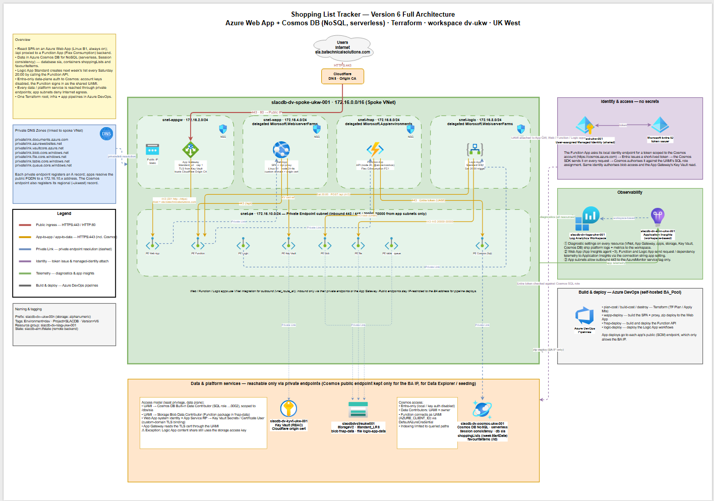

# Version 6 CosmosDB
Version 6 of my Shopping List App swaps the backend from PostgresSQL do a CosmosDB instance. This takes the app from a traditional relational database backend to a document based backend. 

## Solution Components
- **Terraform**: IaC modules to deploy all Azure infrastructure and the External Entra ID tenant.
- **Application Gateway**: Secure entry point to my application URL.
- **Azure Web App**: Hosts the React web application.
- **Cosmos Database**: Data source to store; weekly shopping lists, individual items, and favourite items.
- **Logic App**: Automation to create a blank shopping list for the week ahead.
- **Function App**: API layer to communicate between frontend UI and backend data source.
- **Key Vault**: Secure storage for domain SSL certificate private key.
- **Private Endpoints**: Private communication between all resources.
- **Managed Identity**: Secure (no secrets) authentication between all resources.
- **Log Analytics**: Diagnostic logging enabled on all resources. 
- **Azure DevOps Pipelines**: To deploy infrastructure and application code.

## Architectural Diagram

