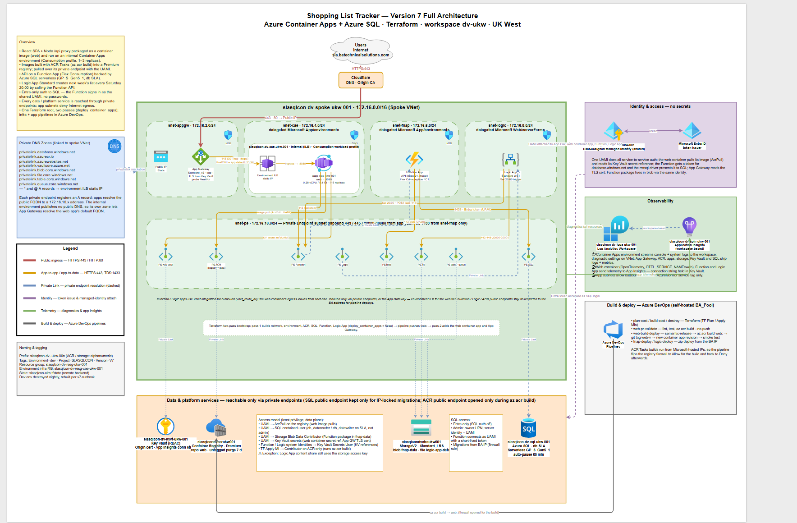

# Version 7 Azure Container App
Version 7 of my Shopping List App reverts back to a SQL back end but this time refactors the frontend from an Azure Web App to an Azure Container App. This represents a major refactor of the app from a ZIP deployment method to containerisation and makes the frontend portable and deployable to docker compatible infrastructure.

## Solution Components
- **Terraform**: IaC modules to deploy all Azure infrastructure and the External Entra ID tenant.
- **Application Gateway**: Secure entry point to my application URL.
- **Azure Container Registry**: Hosts the apps docker container image.
- **Azure Container App**: Hosts the React web application.
- **Azure SQL Database**: Data source to store; weekly shopping lists, individual items, and favourite items.
- **Logic App**: Automation to create a blank shopping list for the week ahead.
- **Function App**: API layer to communicate between frontend UI and backend data source.
- **Key Vault**: Secure storage for domain SSL certificate private key.
- **Private Endpoints**: Private communication between all resources.
- **Managed Identity**: Secure (no secrets) authentication between all resources.
- **Log Analytics**: Diagnostic logging enabled on all resources. 
- **Azure DevOps Pipelines**: To deploy infrastructure and application code. This version includes building the docker image for the app and publishing it to the private container registry.

## Architectural Diagram

